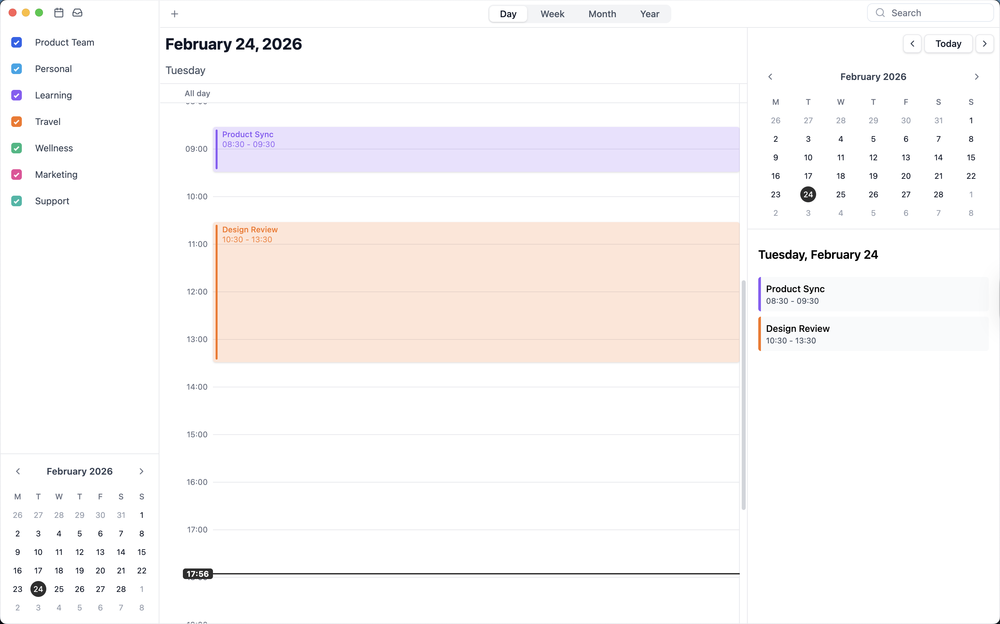
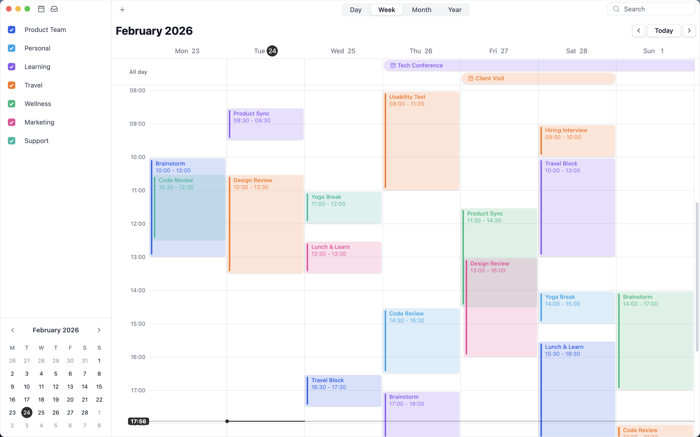
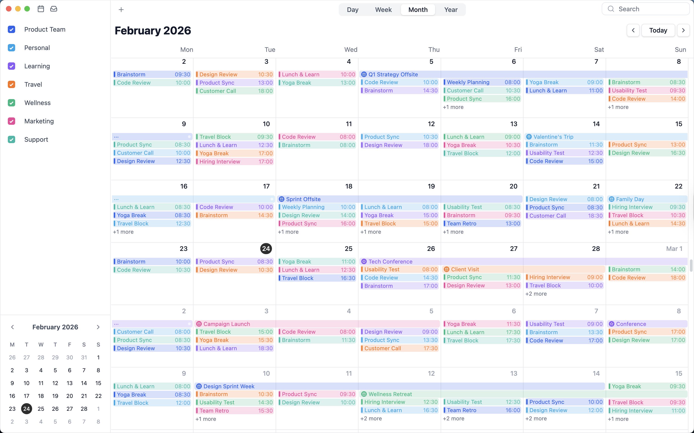
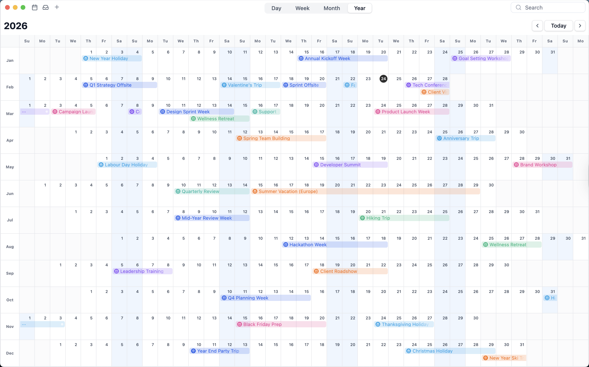
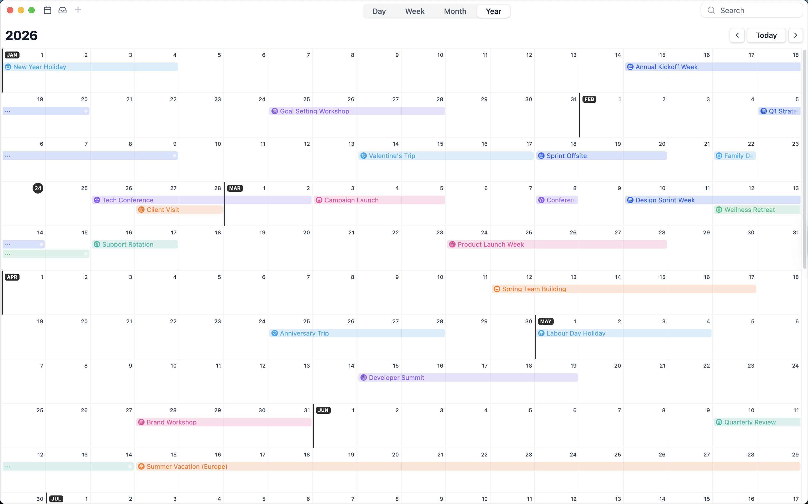
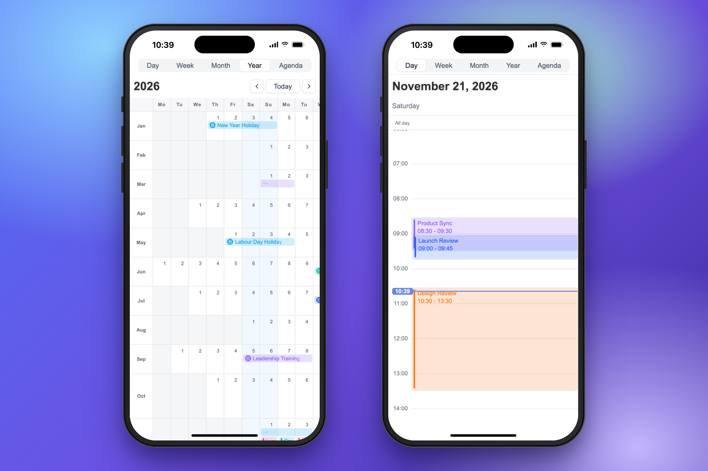
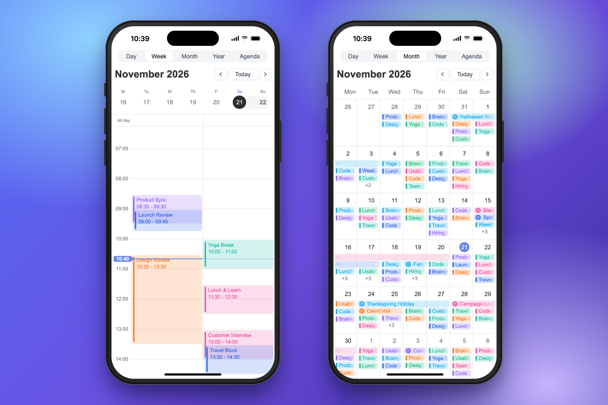
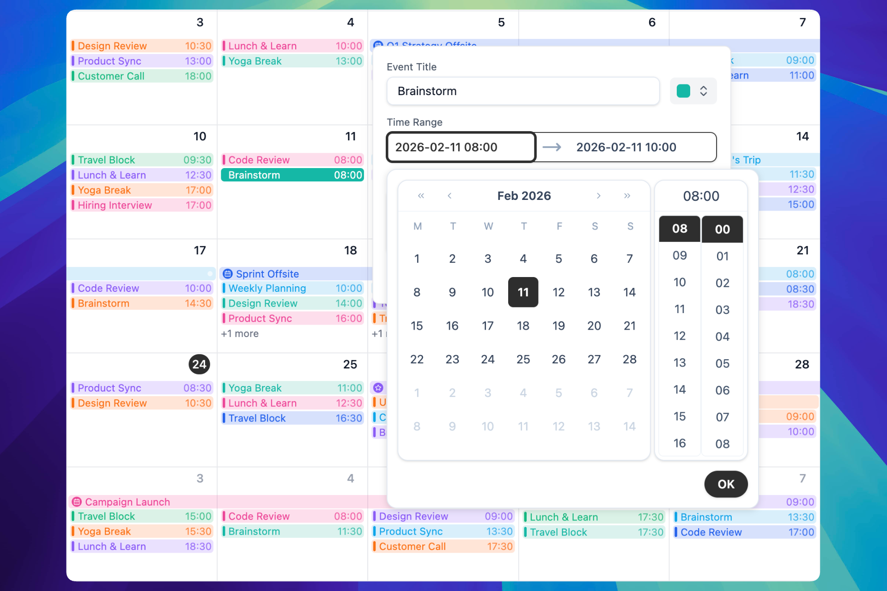
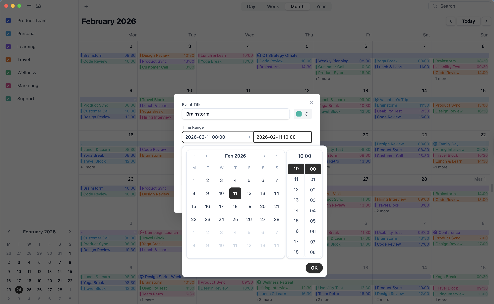
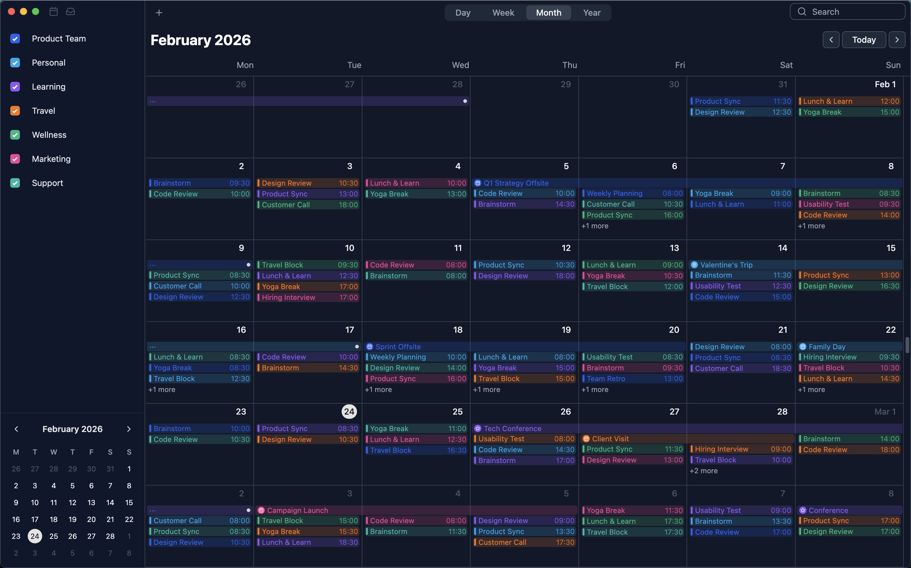

# DayFlow

**English** | [中文](README.zh.md) | [日本語](README.ja.md) | [Getting Started & Contributing](CONTRIBUTING.md)

A flexible and feature-rich calendar component library for **React, Vue, Angular, and Svelte** with drag-and-drop support, multiple views, and plugin architecture.

[](https://www.npmjs.com/package/@dayflow/core)
[](https://github.com/dayflow-js/calendar/pulls)
[](https://github.com/dayflow-js/calendar/blob/main/LICENSE)
[](https://discord.gg/9vdFZKJqBb)

[**Documentation**](https://calendar.dayflow.studio/docs/introduction) ·
[**Live Demo**](https://calendar.dayflow.studio/demo) ·
[**Website**](https://calendar.dayflow.studio) ·
[**Changelog**](https://calendar.dayflow.studio/changelog) ·
[**Blog**](https://calendar.dayflow.studio/blog)

## Quick Start

Install the adapter for your framework, plus the calendar core and drag plugin:

```bash
npm install @dayflow/react @dayflow/core @dayflow/plugin-drag
```

```tsx
'use client';

import { DayFlowCalendar, useCalendarApp } from '@dayflow/react';
import {
  createDayView,
  createWeekView,
  createMonthView,
  createEvent,
  createEventsPlugin,
} from '@dayflow/core';
import { createDragPlugin } from '@dayflow/plugin-drag';
import '@dayflow/core/dist/styles.css';

export default function TeamCalendar() {
  const calendar = useCalendarApp({
    views: [createDayView(), createWeekView(), createMonthView()],
    plugins: [createDragPlugin(), createEventsPlugin()],
    events: [
      createEvent({
        id: 'team-meeting',
        title: 'Team meeting',
        start: new Date(new Date().setHours(10, 0, 0, 0)),
        end: new Date(new Date().setHours(11, 0, 0, 0)),
      }),
    ],
  });

  return <DayFlowCalendar calendar={calendar} />;
}
```

Full walkthrough: **[Getting Started](https://calendar.dayflow.studio/docs/introduction)**.

| Framework | Package                                                              | Guide                                                                |
| --------- | -------------------------------------------------------------------- | -------------------------------------------------------------------- |
| React     | [`@dayflow/react`](https://www.npmjs.com/package/@dayflow/react)     | [Getting Started](https://calendar.dayflow.studio/docs/introduction) |
| Vue       | [`@dayflow/vue`](https://www.npmjs.com/package/@dayflow/vue)         | [Getting Started](https://calendar.dayflow.studio/docs/introduction) |
| Angular   | [`@dayflow/angular`](https://www.npmjs.com/package/@dayflow/angular) | [Getting Started](https://calendar.dayflow.studio/docs/introduction) |
| Svelte    | [`@dayflow/svelte`](https://www.npmjs.com/package/@dayflow/svelte)   | [Getting Started](https://calendar.dayflow.studio/docs/introduction) |

## Documentation

| Topic         |                                                                                                                                                                                                                                                                                                                                                                                                                                                                |
| ------------- | -------------------------------------------------------------------------------------------------------------------------------------------------------------------------------------------------------------------------------------------------------------------------------------------------------------------------------------------------------------------------------------------------------------------------------------------------------------- |
| Core concepts | [Calendar component](https://calendar.dayflow.studio/docs/introduction/dayflow-calendar) · [Events](https://calendar.dayflow.studio/docs/introduction/events) · [Views](https://calendar.dayflow.studio/docs/introduction/views) · [`useCalendarApp`](https://calendar.dayflow.studio/docs/introduction/use-calendar-app)                                                                                                                                      |
| Features      | [Calendar header](https://calendar.dayflow.studio/docs/features/calendar-header) · [Content slots](https://calendar.dayflow.studio/docs/features/content-slots) · [Dark mode](https://calendar.dayflow.studio/docs/features/dark-mode) · [Event dialog](https://calendar.dayflow.studio/docs/features/event-dialog) · [Tasks](https://calendar.dayflow.studio/docs/features/tasks) · [Read-only mode](https://calendar.dayflow.studio/docs/features/read-only) |
| Guides        | [Theme customization](https://calendar.dayflow.studio/docs/guides/theme-customization) · [Global CSS](https://calendar.dayflow.studio/docs/guides/global-css) · [Time zones](https://calendar.dayflow.studio/docs/guides/timezones)                                                                                                                                                                                                                            |
| Plugins       | [Overview](https://calendar.dayflow.studio/docs/plugins/overview) · [Drag & drop](https://calendar.dayflow.studio/docs/plugins/drag) · [Localization](https://calendar.dayflow.studio/docs/plugins/localization) · [Keyboard shortcuts](https://calendar.dayflow.studio/docs/plugins/keyboard-shortcuts) · [Sidebar](https://calendar.dayflow.studio/docs/plugins/sidebar) · [Board](https://calendar.dayflow.studio/docs/plugins/board)                       |
| CalDAV sync   | [Overview](https://calendar.dayflow.studio/docs/caldav/overview) · [Google](https://calendar.dayflow.studio/docs/caldav/google-sync) · [Outlook](https://calendar.dayflow.studio/docs/caldav/outlook-sync)                                                                                                                                                                                                                                                     |

## Beyond the open-source calendar

|                                                           |                                                                                                       |
| --------------------------------------------------------- | ----------------------------------------------------------------------------------------------------- |
| [**DayFlow Pro**](https://pro.dayflow.studio)             | Resource timelines, resource grids, appointment booking, and print-ready output layered on this core. |
| [**DayFlow Scheduler**](https://scheduler.dayflow.studio) | Standalone resource-first scheduler for team planning, grouped rows, and long-running timelines.      |

## Features

### Daily, Weekly, Monthly and Yearly View Types

#### Day View



#### Week View



#### Month View



#### Year View(Fixed-Week)



#### Year View(Year-Canvas)



### Mobile View Support

#### Mobile Day & Year View



#### Mobile Week & Month View



### Multiple Event Detail Panel options

#### Detail Popup



#### Detail Dialog



### Dark Mode Support



### Easy to resize and drag

https://github.com/user-attachments/assets/726a5232-35a8-4fe3-8e7b-4de07c455353

https://github.com/user-attachments/assets/957317e5-02d8-4419-a74b-62b7d191e347

## Contributing

Contributions are welcome! Please feel free to submit a Pull Request.

## Bug Reports

If you find a bug, please file an issue on [GitHub Issues](https://github.com/dayflow-js/calendar/issues).

## Support

For questions and support, please open an issue on GitHub or go to discord.

---
